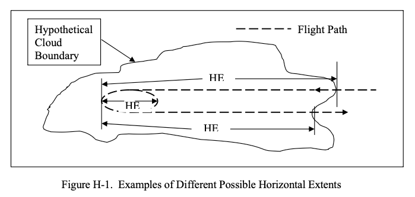

status: draft  
title: Conclusions of the Series on Dr. Jeck    
Date: 2026-10-21 21:00  
tags: Dr. Jeck, Appendix C, SLD, Probability  

### _"... to illustrate the possibilities" [^1]_ 

  
_Public Domain image from DOT/FAA/AR-00/30._  

## Introduction  

Dr. Jeck was described as "A gifted physicist and innovator" [^2]. 
We have seen several examples in this series. 
Several of his proposals have been adopted, while others are still open possibilities.  

## Dr. Jeck's own summaries  

Here are selected conclusions from three of Dr. Jeck's later works:  
 
"Icing Design Envelopes (14 CFR Parts 25 and 29, Appendix C) Converted to a Distance-Based Format [^1]:  

>The methods illustrated here provide the icing practitioner with straightforward, understandable, and
meaningful ways to document, compare, and evaluate data on icing conditions. 
They offer a set of working standards for achieving consistency and uniformity among users. 
Some methods may be more useful than others, depending on the application, but a variety are offered, 
with examples, to illustrate the possibilities.  
The example graphs also illustrate the use of computerized spreadsheet software for graphing icing
variables and for conveniently adjusting or converting the Appendix C envelopes to fit particular
applications. This adds new, modern versatility to the envelopes that are not possible with the
conventional printed (fixed) version.  

"Advances in the Characterization of Supercooled Clouds for Aircraft Icing Applications" [^3]:  

>• The old NACA data and the modern data compare favorably with each other in the
determination of LWC and MVD, even though the measuring techniques are radically
different.  
• The worst icing conditions (in terms of LWC) are below 10,000 ft for stratiform clouds
and above 10,000 ft (in the summertime) for convective clouds. Appendix C wrongly
implies that maximum LWCs are the same over the entire 22,000-ft altitude range.  
• MVDs are much less variable than previously thought. Eighty percent of all MVDs are
within ±5 µm of the mode at 15 µm for layer clouds and within ±6 µm of the mode at 18
µm for convective clouds. Appendix C wrongly implies that all MVDs are equally
probable.  
• The most common MVDs also contain the largest LWCs. The slope of the LWC versus
MVD curves in figure 1 of Appendix C wrongly implies that the LWCs continue to
increase with decreasing MVD below 15 µm.


"Distance-Scaled Water Concentrations versus Mass-Median Drop Size, Temperature, and Altitude in Supercooled Clouds" [^4]:  

>Several innovations for preparing and presenting the data have been introduced and are recommended for
general use by the cloud physics community:  
• Uniform cloud intervals (averages over variable distances for which the droplet concentration, MMD,
altitude, temperature, etc., stay within defined limits) provide an economical way 
to organize large numbers of 1-s samples into a manageable set of averages.
These preserve essential features of the cloud without sacrificing horizontal or vertical resolution where
it is needed.  
• Averaging distance or duration as a variable weighting factor is used for frequency-of-occurrence tabulations
so that short and long averages are not counted the same.  
• Distance-based graphing solves the dual problem of 1) comparing values of a given variable (e.g., LWC)
averaged over different distances from different sources and 2) depicting limiting values of LWC and
MMD as a function of averaging distance.  

From a draft outline of topics by Dr. Jeck, suggesting items he viewed as important:  

```text
Newly-Proposed Solutions
2. ALTERNATE, MORE VERSATILE FORMATS FOR APPENDIX C
    2.1 Appendix C Envelopes in terms of LWC vs HE
    2.2 Appendix C Envelopes in terms of any other LWC-related variable
3. NEW DATA-FINDINGS FROM 28,000 NMI OF IN-FLIGHT ICING CLOUD DATA
4. RETURNING TO AN ENGINEERING-ENABLED (MEASURABLE! AND CALCULABLE!) ICING SEVERITY SCALE
5. INSTRUMENTATION AND ADVICE FOR MEASUREMENTS IN ICING CLOUDS
    5.1 The Need for Standard Procedures for Processing and Presenting Icing Cloud Data For Test and Certification Flights  

```

## Possibilities that were adopted  

As we saw in ["Icing Information Notes"]({filename}treasure.md), 
the "INSTRUMENTATION AND ADVICE FOR MEASUREMENTS IN ICING CLOUDS" were later provided in 
a series of publications.  

As we saw in [Aircraft Icing Intensities]({filename}jeck_icing_intensity.md), 
Dr. Jeck's proposals were eventually largely adopted in the current regulations.  

As we saw in [Natural Probabilities]({filename}jeck%20natural%20probabilities.md), 
several distance (HE) format characterizations were adopted as supplements to Appendix C.  

## The evolution of distance terms  

The terms that Dr. Jeck used for the distance in distance-based methods changed through the years.  

AR-00/30 (2002) used "Horizontal Extent", following the example of the current Appendix C figures.  

AR-07/04 (2007) used horizontal extent, as well as "exposure distance". 

It noted that "horizontal extent" has never been well-defined.
 
  
_Public Domain._  
> _Although horizontal extent is a common term in the icing literature, it has not been defined anywhere.
Therefore, it is defined here in a way that is compatible with conventional usage._  

>Horizontal extent (HE): Any approximately unidirectional horizontal distance in icing
conditions over which an average or maximum value of LWC or
some other variable is of interest.
The HE can be anything from a fraction to the full width of a cloud,
cloud system, or expanse of icing conditions. That is, the HE is not
necessarily the full (edge-to-edge) extent of a cloud or expanse of
icing conditions. For example, the conventional reference or design
distance of 20 statute miles (17.4 nmi) is a legitimate HE, even
though the actual extent of available icing conditions may be much
greater.
The HE is usually of interest in connection with the maximum value
of LWC that can be expected as an average over a specified value of
HE.  
When computing averages from flight data, the HE is conventionally
taken to be the longest unidirectional horizontal distance (UHD) over
which the LWC is averaged. It is possible, however, to select one or
more portions of this longer path for computing averages over
shorter distances. This may be of interest when a long flight path is
punctuated with occasional bursts of greater LWC. In that case, the
overall average is of interest as well as average LWCs that are
possible over shorter distances. These shorter averaging intervals are
legitimate HEs, too. In figure H-1, two typical HEs are shown for a
flight path which enters a cloud (icing conditions) at one edge,
proceeds some distance in cloud, executes one or more racetrack
patterns, and then returns to the original edge to exit the cloud.
Relationship of HE to AD and ED. The AD and ED are usually equal
to or greater than the HE. This is best explained by an example. In
figure H-1, typical HEs are marked off as the longest UHDs along
the flight path. In this same situation, the ED for the aircraft would
be the entire distance traveled inside the cloud, including all the
circuits made around the racetrack pattern. The AD could be the
same as or less than the ED, depending on the application. For
example, if it were only of interest to know what the average LWC
was during the racetrack circuits, then the AD could include only the
distance spent in the racetrack or holding pattern. If it were of interest
to compute a new LWC for every 17.4-nmi interval along the flight
path, then the ADs would all be 17.4 nmi.

Even with the definition Dr. Jeck provided, I am not clear on how to really apply it 
(with "usually", "could include" and "could be" clauses).  

DSWC (2008) uses the term "in-cloud averaging distance", which is probably what the term always should have been, 
including in Appendix C.  

In AR-07/04, a figure from NACA-TN-1939 was included in a discussion of "APPENDIX C—THE ORIGIN AND INTERPRETATION OF HORIZONTAL EXTENT 
SPECIFICATIONS AND THE LWC FACTOR CURVES IN 14 CFR PARTS 25 AND 29 
APPENDIX C". The term "Duration, Minutes" is used.  

  
_Public Domain._  

NACA-TN-1904 used the term "Distance along flight path".  
  
_Public Domain._  

The later NACA-TN-2569, cited in Appendix C Figure 3, 
essentially replotted the data (there are a few more intermediate steps, 
Dr. Jeck took 7 pages to reach this point in his detailed chronology), 
and relabeled it "Horizontal Extent". 
NACA-TN-2569 did not define "horizontal extent" or explain change in term, 
and Dr. Jeck did not note the change in his discussion.  

## Open Possibilities  

Jeck's proposal for "modernized" figures for Appendix C has only been partially adopted. 
The current Appendix C still has the 60+ year-old figures. 
His apparent to make spreadsheet files available did not come to pass. 
I have seen the digitization of figures repeated many times by many people, 
with some implementations better than others. 
["New Replacement Figures for 14 CFR-25, 29, Appendix C"]({filename}app_c_figures.md) 
provides an even more "modernized" version (so you won't have to digitize them yet again), 
that also include interpolation within figures.  

Dr. Jeck's proposal for "refinements" to the Appendix C figures to a distance-based format 
has not yet been adopted (See [Natural Probabilities]({filename}jeck%20natural%20probabilities.md)). 
He noted:  

>The old figures may not be seriously flawed, but they are
overconservative in some details and underconservative in others.    

Dr. Jeck further explains:  

>The basic question for regulatory concerns is, do the graphs and curves in 14 CFR Parts 25 and 29
Appendix C need to be changed?  
The answer depends on whether a more realistic representation of the icing environment is desired,
or whether a simplified set of design criteria is acceptable, or whether a more versatile depiction is
preferred, and whether the graphics are to be modernized for the computer age, or some
combination of these.  
...  
No safety hazard is expected to result if the present envelopes are
kept unchanged, but they are unhelpful for some applications, such as providing altitude-limited
LWCs, determining most probable MVDs, and plotting test points.

Without compelling safety concerns, Appendix C is unlikely to change.  

However, technological innovations, such as un-crewed drones and electrically powered, vertical takeoff aircraft, 
offer new opportunities. 
Regulators have shown signs of willingness to consider new certification approaches, as long as safety is maintained. 
Some of these aircraft operate at altitudes of less than 10,000 ft 
(either due to the mission profile, or technical limitations), 
so Dr. Jeck's works on characterizing conditions below 10,000 ft. may be of particular interest.  

As noted in the [Origins of The Supercooled Cloud Database](jeck%20building%20the%20database.md) 
discussion of "A new characterization of the icing environment below 10,000 feet AGL from 7,000 miles of measurements in supercooled clouds" [^5]:   

> This is a report of accomplishment in response to a growing requirement over the past decade for
a new assessment of aircraft icing conditions in wintertime clouds at altitudes up to about 10,000 feet.
The requirement has been documented in past workshops [1-5], and comes primarily from
the helicopter community which wants ice-protected rotorcraft to meet increasing demands for “all-weather” operations.
Currently, only a few of the larger helicopters are equipped with certification of ice-protection devices.
This is because the current FAA criteria for design and certification of ice-protection equipment results in power
and payload penalties that smaller rotorcraft cannot tolerate.  
The FAA criteria (promulgated in the Federal Aviation Regulations, Part 25 (FAR-25, Appendix C)
were actually designed for large, transport-category aircraft capable of flying to 20,000 feet or more.
For this reason, there have been concerns that the current criteria may be too severe for low-performance aircraft,
such as helicopters, which generally operate at altitudes below 10,000 feet.  

## Final Words  

I have studied Dr. Jeck's works in depth for years. 
I find that I learn something new each time I re-read one, 
such as when writing this series.  

I encourage you to read Dr. Jeck's works. 
I hope that you find them as rewarding as I have.  

## Related  

This is part of the series [28,000 Miles of Data: The Publications of Dr. Richard Jeck]({filename}jeck.md)  

## Notes  

[^1]: Jeck, Richard K., Icing Design Envelopes (14 CFR Parts 25 and 29, Appendix C) Converted to a Distance-Based Format, DOT/FAA/AR-00/30, April 2002. [ntrl.ntis.gov](https://ntrl.ntis.gov/NTRL/dashboard/searchResults/titleDetail/PB2002107034.xhtml)  
[^2]: Obituary [loudounfuneralchapel.com](https://www.loudounfuneralchapel.com/obituaries/richard-jeck/obituary)  
[^3]: Richard K. Jeck: Advances in the Characterization of Supercooled Clouds for Aircraft Icing Applications. DOT/FAA/AR-07/4, Appendix C, November 2008. [web.archive.org](https://web.archive.org/web/20161221102659/http://www.tc.faa.gov/its/worldpac/techrpt/ar074.pdf)  Note that there is a different pdf file at ntrl.nist, but that copy has blanks for some figures.  
[^4]: Jeck, R. K.: Distance-Scaled Water Concentrations versus Mass-Median Drop Size, Temperature, and Altitude in Supercooled Clouds. J. Atmos. Sci., 65, 2087–2106, 2008, [journals.ametsoc.org](https://journals.ametsoc.org/view/journals/atsc/65/7/2007jas2522.1.xml)  
[^5]: Richard Jeck: "A new characterization of the icing environment below 10,000 feet AGL from 7,000 miles of measurements in supercooled clouds". 1985 
[ntrs.nasa.gov](https://ntrs.nasa.gov/citations/19860002276)  
