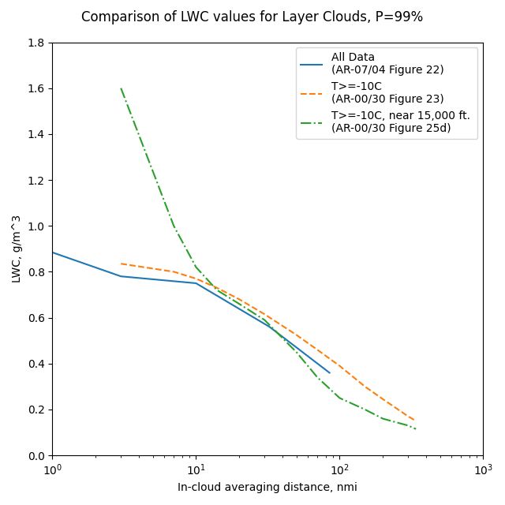

status: draft  
title: Natural Probabilities    
Date: 2026-09-20 12:00
tags: Dr. Jeck, Appendix C, Probability

### _"what is the probability of finding such a test exposure in nature?"_  

  
_Public Domain figure from DOT/FAA/AR-00/30._  

## Introduction  

A 28,000 nmi database is large enough to calculate 
meaningful probabilities, which Dr. Jeck termed Natural Probabilities.  

He also used the data to make the remarkable proposal of replacing the figures in Appendix C 
with distance and probability based ones. 
While this has not yet been adopted, some of his proposals have been adopted as supplements.  

## Natural LWC Probabilities  

Dr. Jeck introduces the term "Natural LWC Probabilities" in the context of discussing 
analysis of flight test data in DOT/FAA/AR-00/30 [^1]:  

>3.2 COMPARING WITH NATURAL LWC PROBABILITIES.  
> 
>One comparison that is not possible with Appendix C is the question of how common, or
uncommon, was a particular test flight icing encounter? Or, how representative of nature is a
particular icing wind tunnel exposure or computer simulation? In other words, what is the
probability of finding such a test exposure in nature?  
> 
>Figure 23 shows a set of LWC probability curves derived from about 23,000 nmi of flight data in
stratiform icing conditions. Any given curve indicates the probability that randomly encountered,
stratiform icing conditions will have an average LWC somewhere below the curve. For example,
the 50% curve means that half of the LWC averages will lie below the curve and half will lie above
it. The 90% curve means that 90% of all LWC averages can be expected to lie below it, for any
given averaging distance, or horizontal extent.  
> 
>The sample LWC trace has been plotted on this graph to determine where it lies in the realm of
probabilities. It is already known from earlier comparisons to the Appendix C envelopes that the
sample encounter contained LWCs considerably below the maximum that could be expected.
Figure 23 shows exactly how far below the maximum that is. The encounter seems quite acceptable
since the cumulative average LWC is greater than the 50% value the entire time. It starts out at
perhaps the 70% level and gradually drifts down toward an average (50%) encounter as the flight
proceeds.  

  
 
This data is replotted in later publications, 
although the different plotting software and scales might not make it readily apparent. 
These are the same data, to my ability to digitize the curves: 

DOT/FAA/AR-07/04 Figure D-3:  
  

"Distance-Scaled Water Concentrations versus Mass-Median Drop Size, Temperature, and Altitude in Supercooled Clouds" [^3] Figure 11a also matches (not shown).  

A plot of the data is also included in AC 20-73A (2016) [^4], Appendix M, "FINDING NATURAL ICING CONDITIONS FOR TEST PURPOSES":  

  

A series of figures in DOT/FAA/AR-00/30 filter the data to a limited range of altitudes. 
Here is the figure for near 15,000 ft.:  

  

## Natural probabilities for all data  

DOT/FAA/AR-07/04 includes a plot made with all 28,000 miles of data.  

  

This is also plotted in "Distance-Scaled Water Concentrations versus Mass-Median Drop Size" [^3] Figure 6, 
separated into convective and layer cloud subplots, which makes digitizing the curves easier.  

<!--
We can compare the characterizations mentioned at probability P=99% 
(where all three have results lines shown):  

  

-->

## Data miles and Natural Probabilities  

DOT/FAA/AR-07/04 describes the use of data miles:  

>A.3 DATA MILES AS A MEASURE OF FREQUENCY OF OCCURRENCE.  
During the early phases of this project, it became clear that usage of number of cases or number
of events, as is conventionally done to represent the frequency of occurrence of any of the
variables, was unsatisfactory. The deficiency was twofold. First, momentary icing events would
incorrectly carry just as much statistical weight as long-lasting events. Thus, there was no way
to emphasize the statistical importance of an extended encounter with an extreme value of LWC,
for example, compared to a relatively insignificant, brief encounter. Second, the reader would
have no information as to whether a given number of events represented 5 miles or 500 miles of
in-flight measurements.  
Data miles were, therefore, chosen as the most informative measure of frequency of occurrence.
The term is defined as the distance flown (in nautical miles) during an individual icing event.
This convention automatically weights each icing event (or measurement of LWC, for example)
by its duration or extent. The other principal advantage is that the reader can easily judge the
statistical significance of a data set by the number of data miles it represents.

"Distance-Scaled Water Concentrations versus Mass-Median Drop Size" also notes about the probability lines:  

>These are actually hybrid graphs—the plotted points are individual averages over uniform cloud intervals to
show the basic elements of the database (see the appendix). 
The curves depict the cumulative LWC probability for generally longer cloud transects consisting of
one or more uniform intervals strung together until the research airplane leaves the cloud or reverses direction.
This has the effect of reducing the number of data points and shifting the overall averages toward the
lower right in the graph.  
The scatterplots in Figs. 6a and 6b are recommended for use by experimentalists who wish to compare their
LWC measurements to the background of those made by many others. 
(Figures 8, 10, 11, and 12, in terms of LWC percentiles, are also good for this purpose.) 
They may be useful for selecting realistic LWCs for atmospheric 
models in which information on scale effects for LWC has been wanting.  

So, the lines are based on the data points for a cloud pass, 
collected into the total miles and a distance-averaged LWC. 
For many cases, there is only one measurement in the cloud pass. 
However, for hundreds of cases there was more than one measurement (up to 14). 
This significantly reduces the number of individual points available to for the 
probability lines with.  

## MVD Natural Probabilities  

In DOT/FAA/AR-07/04, Dr. Jeck discusses the advantages of the distance and probability based characterizations of 
icing, in the context of a proposal to replace the existing Appendix C figures:  

>All proposals de-emphasize MVD as a variable and promote exposure distance (horizontal extent)
as a more useful variable instead.  
In any case, a modernized version of Appendix C would convert the new or old figures to
computerized spreadsheet charts for a cleaner appearance, ease of use with word processors, and
the ability to customize the figures for particular applications.  
The rationale behind each of these possibilities is explained in the main body of this report.
These new types of envelopes and curves are recommended for consideration as an improved and
more informative picture of icing conditions aloft. Basically, they emphasize practical utility and
the elimination of unnecessary features. New information can be added, such as seasonal
dependences of LWC on temperature and altitude, and probability curves for LWC, temperature,
and MVD. Such information has been called for as an aid in  
• selecting design values of LWC and temperature as a function of altitude, for altitude-limited 
or scenario driven applications. These are especially of interest for military
aircraft, but they also apply to helicopters in general.  
• selecting realistic (naturally occurring) combinations of LWC, MVD, and OAT for icing
wind tunnel tests or computerized ice accretion models.  
• setting realistic expectations for finding various values of LWC, MVD, and OAT during
test flights in natural icing conditions.  
• providing operational guidance to weather briefers and forecasters in determining typical
and maximum expected icing conditions as a function of altitude and temperature aloft,
by season of the year.  

>3.1.2 Recommendation for Consideration.  
As a result of these differences, refinements to the [Appendix C] figure 1 (or figure 24) LWC envelopes are
proposed in figure 25. These new curves are more realistic and their adoption would update the
current design criteria in Appendix C. The old figures may not be seriously flawed, but they are
overconservative in some details and underconservative in others.  
> 
>   
> 
> 
>   

I found 15 citations for DOT/FAA/AR-07/04, 
but I did not find one that mentioned the proposed new Appendix C figures. 
Some were in languages that I cannot read, 
but none of the figures implied the use of Dr. Jeck's proposed figures to me. 
The closest that I found was this:  
  
_From [^5]._  

While the proposal to replace the Appendix C figures has not yet been adopted, 
several others have been adopted into AC 20-73A as supplements, as we saw in 
[Origins of The Supercooled Cloud Database](jeck%20building%20the%20database.md):  

>APPENDIX M. FINDING NATURAL ICING CONDITIONS FOR TEST PURPOSES  
> 
>  
> 
>APPENDIX O. WAYS TO EVALUATE ICING EXPOSURES RELATIVE TO APPENDIX C  
> 
>   
> 
>APPENDIX P. USING ICING RATE TO DOCUMENT ICING EXPOSURES  

The rationale for de-emphasizing MVD is summarized:  

>2.2.1 Layer Clouds.  
> 
>Figure 11 shows that the mode (most frequent) MVD is about 15 µm. About 80% of all MVDs
fall in the 10-µm interval from 10 to 20 µm. (About 50% of the MVDs are contained within a
narrower 5-µm interval centered at 15 µm.) Only about 10% of MVDs are larger than 20 µm and
about 10% are smaller than 10 µm. The few (1.5%) MVDs larger than 30 µm are probably due to
occasional occurrences of freezing drizzle. This means that if drop sizes were not measured during
icing test flights in natural layer clouds, one could safely assume that the MVD is within the 10 to
20 µm range with 80% confidence. On the other hand, about 55% of the MVDs are smaller than
15 µm. This means that if MVDs of 15 µm or greater are required during natural icing flight tests,
to be within the range covered in Appendix C (figure 1), then about half of the flight time in icing
conditions will be wasted because the available MVDs will be too small.  
> 
>    
> 
>Another way of looking at MVD probabilities is shown in figure 15. There, the maximum
probable LWC for various MVDs is displayed as well as the longest distance that a given
combination of LWC and MVD can be expected to last. The larger the MVD, the shorter its HE
and the rarer its occurrence. Obviously, MVDs near 15 µm are a preferred or equilibrium state for
stratiform clouds, and are where LWCs can be the largest and last the longest.  
> 
>   

## Potential bias in the Database  

The Natural Probabilities tacitly assume ramdom observations of the data points. 
Dr. Jeck addressed some sources of bias.  

>2.4 AIR TEMPERATURE.  
The frequency of occurrence of various icing event temperatures4 is given in figures 18 and 19.
The air temperatures recorded in the database are most frequently in the range of about -5° to
-15°C. The lowest temperature for any event in the database is about -39°C for both convective
clouds and layer clouds.  
> 
>   
> 
> To some extent, the frequencies of occurrence seen among the various variables in the database do
not represent the natural frequencies of occurrence that would result from truly random samples in
the atmosphere. There are some sampling biases such as described here for the temperature data.
Figures 18 and 19 show that a majority of the samples occurred at temperatures in the vicinity of
-10°C. This result is partly due to the popularity of the -10°C flight level among researchers in
cloud seeding (weather modification) experiments. About 35% or more of the modern data came
from cloud seeding projects.  
Figures 18 and 19 also show that only about 10% of the samples occurred at ambient air
temperatures above -3°C and 10% below -20°C. The shortage of data at temperatures between -3°
and 0°C is due to the intentional avoidance of this temperature regime by both the modern and the
NACA flights. The NACA researchers required lower temperatures to avoid runoff or shedding of
ice from their rotating cylinder devices. The low frequency of measurements at temperatures
below -20°C is due to the difficulty in finding clouds that have not already glaciated at those
temperatures. Clouds that are composed entirely of snow or ice crystals (i.e., no supercooled
droplets) are not considered here. Reference 10 describes 7000 nmi of measurements obtained
separately for characterizing these snow and ice crystal clouds.  
 
I have not found attempts to further address potential bias in his other works.  

However, the ACTA report [^5] has a figure similar to Figure 18, 
that may support that encounters in the range -10C to -5C are naturally more common.
Perhaps the test plan sought out those temperatures, I cannot read the text to assess this. 
  
_From [^5]._  

## Related  

This is part of the series [28,000 Miles of Data: The Publications of Dr. Richard Jeck]({filename}jeck.md).  

Methods for working with Natural Probabilities are discussed in [Working with Natural Probabilities]({filename}Jeck%20working%20with%20natural%20probabilities.md).  
 
## Notes  

[^1]: Jeck, Richard K., Icing Design Envelopes (14 CFR Parts 25 and 29, Appendix C) Converted to a Distance-Based Format, DOT/FAA/AR-00/30, April, 2002. [ntrl.ntis.gov](https://ntrl.ntis.gov/NTRL/dashboard/searchResults/titleDetail/PB2002107034.xhtml)  
[^2]: Richard K. Jeck: Advances in the Characterization of Supercooled Clouds for Aircraft Icing Applications. DOT/FAA/AR-07/4, Appendix C, November 2008. [web.archive.org](https://web.archive.org/web/20161221102659/http://www.tc.faa.gov/its/worldpac/techrpt/ar074.pdf)  Note that there is a different pdf file at ntrl.nist, but that copy has blanks for some figures.  
[^3]: Jeck, R. K.: Distance-Scaled Water Concentrations versus Mass-Median Drop Size, Temperature, and Altitude in Supercooled Clouds. J. Atmos. Sci., 65, 2087–2106, 2008, [journals.ametsoc.org](https://journals.ametsoc.org/view/journals/atsc/65/7/2007jas2522.1.xml)  
[^4]:
FAA Advisory Circular AC No. 20-73A: Aircraft Ice Protection. August 16, 2006. [faa.gov](https://www.faa.gov/regulations_policies/advisory_circulars/index.cfm/go/document.information/documentID/22031)  
[^5]: 闫文辉, et al. "基于飞机探测的陕西及周边地区结冰云层微物理特征分析." ACTA AERODYNAMICA SINICA (2024). [sciengine.com](https://www.sciengine.com/parse/pdf/0258-1825/16C2B4454B3B48A8AA99873520E4C7C6.pdf)  
