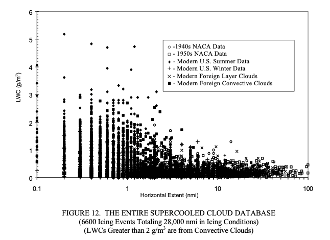
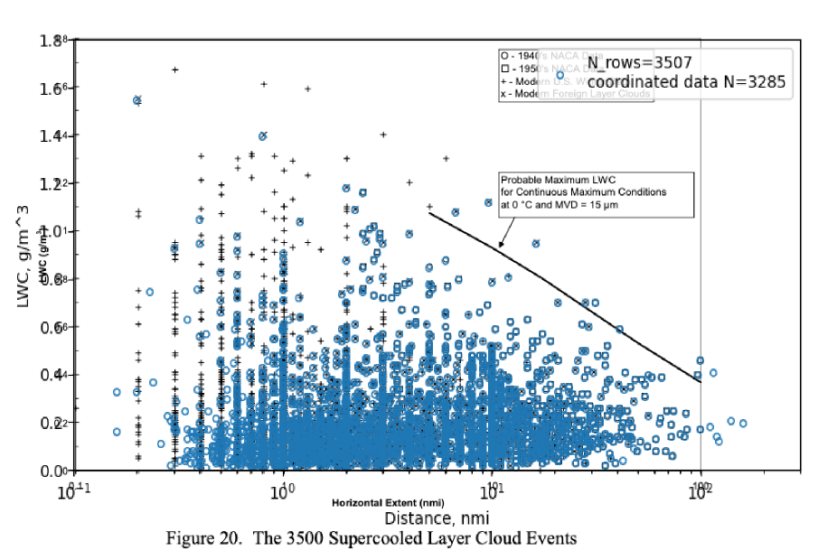

status: draft  
title: Using the Supercooled Cloud Database  
Date: 2026-10-21 20:00  
tags: Dr. Jeck, Appendix C, Probability  

### _"The confidence in the curves is strongest where the data points are plentiful."[^1]_   

  

## Introduction  

With over 6,000 measurements and 28,000 nmi of natural icing flight test data, 
there are many analyses that can be performed.  

Here, I will attempt to reproduce some of the Natural Probability curves.  

## Files provided for the SCDB  

I will refer to Dr. Jeck's published values as the Supercooled Cloud Database or SCDB.  

The database files I received I will refer to at the spreadsheet or spreadsheets.  

There are area where they are not exactly the same, as will be shown below.  

I requested a copy of the SCDB from the FAA, and was provided with a copy. 
It came as two spreadsheet files, 
"Convective Cloud Icing Events_original.xls" and "Layer Cloud Icing Events_original.xls". 
There is only one sheet per file, and no macros, so these are essentially rows and columns of data 
(like a .csv file).  

There were also pdf files "Sources of the Data.pdf" and "Explanation of the Variable_WithComments.pdf" 
with sources of the data and explanations of the columns.  

The data columns in the two spreadsheets are largely similar, 
the two files can be merged by using the superset of columns.  

Two key columns of data are DISTANCE (in nmi) and AVGLWC (average LWC, in g/m^3).  
These are apparently the values used to make Figure 12.  

## The challenge of differences between Dr. Jeck's published values and the spreadsheets  

There are differences apparent between what Dr. Jeck plotted in Figure 12 from DOT-FAA-AR-00-30 [^2], 
and the values in the database that I received.  

  
_Public Domain image._  

When I plotted the points from the database that I received on top of Figure 12, 
some of the points correspond exactly, but many do not. 
The total calculated miles from the spreadsheet (28,029 nmi), however, 
are quite similar to the 28,032 nmi from the provided "Sources of the Data.pdf" file. 
The spreadsheets have 6742 rows, but not every row has "coordinated" values
(both the DISTANCE and AVGLWC values greater than zero). 
There are 6519 events with coordinated values in the database.  

  

For AR-07/4 [^3] Figure 20, it notes 3500 layer cloud data points, 
but the layer-cloud portion of the database that I received had 3285 rows with coordinated values. 
Some of the points do not correspond.  

    

It is not clear to me if the spreadsheets that I received were an earlier or later versions from
the database that Dr. Jeck used in the year 2000 to plot Figure 12.  

## Analysis using the spreadsheet data  

Setting aside the differences in the data between the Database and the Spreadsheet, 
I tried to reproduce the probability lines for AR-07/04 Figure 22.

  
_Public Domain image._  

As noted earlier in [Natural Probabilities]({filename}jeck%20natural%20probabilities.md), "Distance-Scaled Water Concentrations..." [^1] has similar figures separated between lay and convective clouds, 
where it is easier to digitize the curves.  

"Distance-Scaled Water Concentrations..." notes:  

>The LWC percentile curves were obtained from a Weibull distribution fitted to cumulative LWC frequencies 
in each of several distance intervals (0.2–1, 1–5, 5–15, 15–50, 50–120, and 120–200 n mi for layer clouds
and 0.1–1.5, 1.5–3, 3–6, 6–12, 12–24, and 24–48 n mi for convective clouds).  

The layer cloud bins were used with the spreadsheet data. 
The results are reported at the bin distance centroids. 
The results have some similarity to Figure 22 for the P=99% line:  

  

The 120-200 nmi bin had only three data points, 
so it is only by happenstance that a seemingly reasonable result was found for that bin. 
Given the previously noted differences in the underlying data, 
I was pleasantly surprised to have any correspondence.  

## Collected cloud pass data  

The SCDB consists of measurements from diverse organization for diverse purposes. 
Many of the individual measurements were not terminated because the cloud was exited. 
Many used prescribed distance or time targets for the measurement. 
Jeck collected and averaged such sequential measurements and 
treated them as one measurement.   

In "Distance-Scaled Water Concentrations...", it is stated:  

> The curves depict the cumulative LWC probability for generally longer cloud transects consisting of
one or more uniform intervals strung together until the research airplane leaves the cloud or reverses direction.  

Some key Database columns:  

|Term | Explanation                                                                                                                             |
|---|-----------------------------------------------------------------------------------------------------------------------------------------|
|CLDGRP | A letter, A, B, C, etc., denoting a group of similar type clouds being sampled.                                                         |
|COUDNUM| A number, 1, 2, 3, etc., denoting which cloud in CLOUDGRP contributed to the data for the present observation.                          |
|CLD_PASS| A number 1, 2, 3, etc., indicating which pass the current observation represents through the cloud identified by CLOUDGRP and CLOUDNUM. |
|EVENTDEF| A letter code, A, B, C, etc., to indicate why the sample was terminated. The code is given in table A-1. [A is "Aircraft exits main cloud"]                    |

The spreadsheet data was interrogated to find such cases. 
Candidate cloud pass data measurements were required to have occurred on the same project, 
day, cloud group, cloud number, and cloud pass, with the final measurement noted as exiting the cloud.
(There is no database column noting change in direction). 
I am not sure that this is how Dr. Jeck implemented it.  

The measurements for these cloud passes were "strung together" or collected into one measurement 
at the total distance and the distance-averaged LWC value. 

"Distance-Scaled Water Concentrations..." [^1] notes:  

> This has the effect of reducing the number of data points and shifting the overall averages toward the
lower right in the graph.

For one case ('CASP:1986' March 10, 1986, Orig Order=1212), 
19 measurements in once cloud pass were collected into one representative point:  

  

162 cloud pass cases (containing 675 measurements) were found to meet the criteria.  
As noted above, this reduces the total number of points:  

  

The result again compares fairly well to the Figure 22 result:  

  

## Data filtered for temperature and MVD ranges  

Dr. Jeck noted that the majority of icing cases are at temperatures above -10C 
and MVD values near 15 micrometers. These also correspond to the highest LWC values. 
So, some figures filtered data to be in those ranges.  

However, this reduces the number of points available for use in the Weibull distribution fit.  

"Distance-Scaled Water Concentrations..." [^1] notes:  

>The confidence in the curves is strongest where the data points are plentiful. 
From there the curves have simply been judiciously extrapolated into the data-sparse regions.  

Figure D-3 of AR-07/04 plots probability lines out to 310 nmi. 
As there are few data points beyond 100 nmi, 
no points beyond 160 nmi (even for the collected cloud pass data), 
the lines must have been "judiciously extrapolated". 
It appears that the Appendix C Figure 3 slope was used.  

  
_Public Domain image._  

While Figure D-3 does not note it, 
AR-00/30 Figure 23 notes that a temperature range of -10C<=T<=0C was used.  

  
_Public Domain image._  

The spreadsheet data points, when filtered, were reduced by about 60% to 1011 points. 
This was adequate for four of the distance bins, 
but too sparse for the bin with the largest distances to be used for reliable analysis.  

  

## Conclusions  

The apparent differences between the Supercool Cloud Database and the Spreadsheet version 
limit the fidelity of comparisons.  

I am interested if readers have versions of the database that they could share 
to see if there are similar differences.  

The collection of cloud pass data into one representative point was not described in great detail, 
so I cannot be sure that I have implemented it in the same way as Dr. Jeck.  

I accept Dr. Jeck's published works as the most accurate results from analysis of the data.  

## Related  

This is part of the series [28,000 Miles of Data: The Publications of Dr. Richard Jeck]({filename}jeck.md)  

## Notes  

[^1]: Jeck, R. K.: Distance-Scaled Water Concentrations versus Mass-Median Drop Size, Temperature, and Altitude in Supercooled Clouds. J. Atmos. Sci., 65, 2087–2106, 2008, [journals.ametsoc.org](https://journals.ametsoc.org/view/journals/atsc/65/7/2007jas2522.1.xml)  
[^2]: Jeck, Richard K., Icing Design Envelopes (14 CFR Parts 25 and 29, Appendix C) Converted to a Distance-Based Format, DOT/FAA/AR-00/30, April, 2002. [ntrl.ntis.gov](https://ntrl.ntis.gov/NTRL/dashboard/searchResults/titleDetail/PB2002107034.xhtml)  
[^3]: Richard K. Jeck: Advances in the Characterization of Supercooled Clouds for Aircraft Icing Applications. DOT/FAA/AR-07/4, Appendix C, November 2008. [web.archive.org](https://web.archive.org/web/20161221102659/http://www.tc.faa.gov/its/worldpac/techrpt/ar074.pdf)  Note that there is a different pdf file at ntrl.nist, but that copy has blanks for some figures.  
